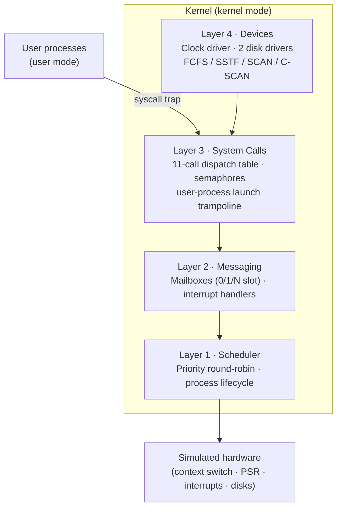

# OS Kernel Design Notes

**Design notes from a four-layer operating system kernel I built in C: a preemptive scheduler, mailbox IPC, a user/kernel system-call boundary and device drivers with four disk-arm scheduling algorithms.**

The kernel runs on the *THREADS* simulation framework, which provides simulated hardware (CPU context switching, a processor status register, timer/I/O/syscall interrupts, disks and terminals). Everything above that hardware layer is mine: about 4,300 lines of C across the four layers.

> **Source code is private.** This repo documents the architecture, design decisions and the hardest bugs. Code walkthroughs are available on request.

---

## Architecture

Each layer may only use the API of the layer below it. For example, Layer 3 cannot disable interrupts and Layer 2 cannot call the dispatcher directly. Those constraints mirror how real kernels isolate subsystems and shaped most of the design decisions below.

---

## Layer 1: Scheduler

- **Boot sequence** (`bootstrap()`): initializes the process table, ready queues and a watchdog idle process.
- **Preemptive priority round-robin scheduling.** Per-priority ready queues with head and tail pointers give **O(1) enqueue** and **O(P) dequeue** (P = number of priority levels).
- **Process lifecycle API:** `k_spawn`, `k_exit`, `k_wait`, `k_join`, `k_kill`, `k_getpid`, with parent/child trees, sibling lists and join-waiter lists.
- **Safety:** kernel-mode enforcement, interrupt management through processor-status-register manipulation, deadlock detection and process-table overflow handling.
- A debug flag toggles detailed tracing on and off.

**Result:** all 32 scheduler test scenarios pass, including multi-level process hierarchies, FIFO ordering for join waiters and signal propagation.

## Layer 2: Messaging (IPC)

- **Mailbox IPC** with three mailbox types: zero-slot (rendezvous), single-slot and multi-slot.
- Blocking and non-blocking `send` / `receive`, with **FIFO ordering enforced independently of process priority**.
- Doubly linked waiter queues for blocked senders and receivers; a **global slot pool** bounds memory use.
- A single `service_mailbox` routine owns the job of waking blocked senders when a slot frees up. Centralizing that logic removed a class of ordering races.
- **Interrupt handlers:** clock (every 5 ticks), I/O (routes device status to per-device mailboxes) and the system-call dispatcher.

## Layer 3: System Calls

- **User/kernel boundary.** User processes reach the kernel only through a syscall trap into an **11-call dispatch table**.
- A kernel-mode trampoline (`launchUserProcess`) manages the processor-status-register transition into user mode.
- **Semaphore subsystem** (`k_semcreate`, `k_semp`, `k_semv`, `k_semfree`) built **on top of mailboxes** rather than by disabling interrupts, which this layer is not allowed to do. Waiters sit in a priority-ordered queue.
- Process management syscalls: `spawn`, `wait`, `exit`.

**Result:** all 29 system-call test scenarios pass, with output byte-identical to the reference.

## Layer 4: Device Drivers

- **Clock driver:** manages sleeping processes in a wake-time-sorted list.
- **Two disk-driver processes**, one per disk. Read and write requests are queued asynchronously, and each requester blocks on its own semaphore until its I/O completes.
- **Disk-arm scheduling, all four algorithms:**

| Algorithm | Behavior |
|---|---|
| FCFS | Service requests in arrival order |
| SSTF | Shortest seek time first: pick the closest track |
| Elevator (SCAN) | Sweep in one direction servicing requests, then reverse |
| One Direction (C-SCAN) | Sweep one way, jump back, sweep again for more uniform wait times |

FCFS and SSTF output matched the reference traces in every test scenario.

---

## Debugging case studies

### 1. Join waiters woke in reverse order
Ten processes all called `k_join` on the same target, and they woke newest-first. The join helper was **prepending** waiters. Switching to tail-append restored FIFO semantics, a one-line fix that only showed up because a test hammered fairness.

### 2. `mailbox_free` race: four defects that had to be fixed together
Processes blocked on a mailbox that was being freed sometimes returned `-1` instead of the required `-5` (signaled). Root cause analysis found four interacting defects:

1. **Status ordering.** The mailbox had to be marked `RELEASED` *before* waking any waiter, so woken processes see it gone instead of looping.
2. **Incomplete signaling.** Only blocked *senders* were signaled. Blocked *receivers* also needed `k_kill`.
3. **Mutation during iteration.** The sender and receiver waiter lists had to be **snapshotted** (capture head, null the list) before walking them, because woken processes modify them.
4. **Final state.** The slot had to end as `EMPTY`, not `RELEASED`, because lookup only returns in-use entries and a lingering `RELEASED` entry allowed operations on a dead mailbox.

The fixes only work when applied in that order, which is a good illustration of how subtle concurrent resource teardown is.

---

## Takeaways

- **Treat the spec as the primary artifact.** Several hours of debugging traced back to constraints I had skimmed past. I now write pseudocode against the full spec before writing code.
- **Layer constraints are a feature.** They force clean API boundaries, the same way real kernels are structured.
- **Concurrency bugs live between steps.** For any multi-step operation that crosses a process boundary, I now ask *"what if another process runs between step N and N+1?"* before writing it.
- **Check interrupt enable/disable symmetry first.** Many "impossible" failures were functions returning with interrupts in the wrong state.

## Skills demonstrated

`C` · `process scheduling` · `context switching` · `IPC / message passing` · `semaphores & synchronization` · `user/kernel mode separation` · `interrupt handling` · `device drivers` · `disk scheduling (FCFS/SSTF/SCAN/C-SCAN)` · `concurrency debugging`

## Author

**Devante Metoyer** · [LinkedIn](https://linkedin.com/in/devantedmetoyer) · [GitHub](https://github.com/DDMetoyer)

Text licensed under [CC BY 4.0](LICENSE).
